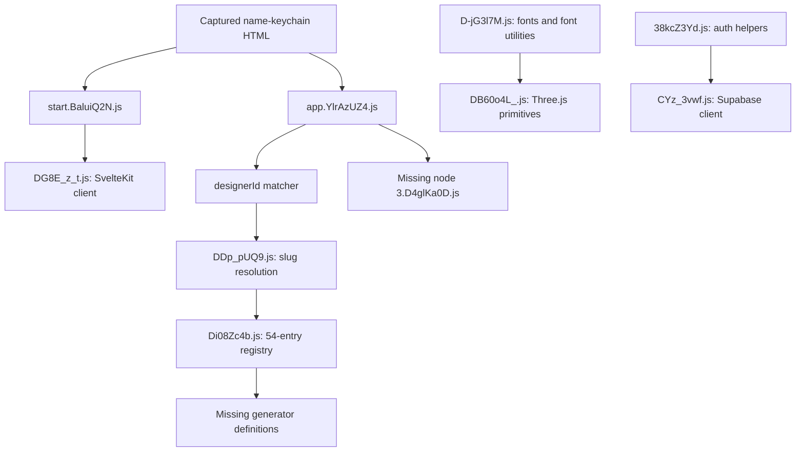

# PixnPrints public artifact audit

Research date: 2026-10-16 (Asia/Manila). This is a static, incomplete-coverage audit, not a recovered application or a runtime certification. No application implementation was changed. Existing working-tree changes predate this audit.

## What is recoverable

- **Confirmed:** 91 ZIP chunks, two standalone JS entry points and one HTML capture are supplied. All 93 JavaScript files parse successfully with the installed Acorn parser. Byte sizes, SHA-256 fingerprints, imported/exported aliases and missing references are recorded in [file-inventory.md](file-inventory.md), [dependency-graph.md](dependency-graph.md) and [artifact-index.json](artifact-index.json).
- **Confirmed:** `app.YlrAzUZ4.js`, `__vite__mapDeps`, contains 216 preload asset strings. Only 91 have matching supplied basenames. Its 29 dynamic node imports are all absent, including `3.D4glKa0D.js`. Eleven manifest entries are CSS assets, also absent. A manifest reference is not recovered implementation.
- **Confirmed:** `Di08Zc4b.js` contains 54 catalog entries. Its generator definition modules are missing. See [generator-catalog.md](generator-catalog.md) for the actual metadata and access caveats.
- **Confirmed:** `name-keychain` captures SEO metadata, a loading preview, skeleton controls, and hydration of nodes `[0,3]`. It advertises optional border, text outline, keyring, STL and 3MF. It does not contain the editor controls or modeling implementation.
- **Unavailable:** the actual Name Keychain body builder, keyring boolean operations, renderer configuration and exporter pipeline cannot be recovered from these inputs. Shared font conversion, annular ring extrusion and disposal helpers are recoverable, but their use by the missing generator is unverified. See [geometry-engine.md](geometry-engine.md).

## Entry, route and data flow

**Confirmed:** the route dictionary `St` (character offset 18057 in `app.YlrAzUZ4.js`) maps `/[designer=designerId]` to node 3. `Tt` contains matcher `vt` (offset 10602); it checks whether the imported resolver returns a non-null result. `DDp_pUQ9.js` resolves slug aliases using catalog titles and `DPtMCyeK.js` IDs; `DR0tZGP-.js:r` lowercases, replaces non-ASCII-alphanumeric runs with hyphens, then strips edge hyphens. All offsets are zero-based UTF-16 character offsets in the unmodified input.

**Confirmed:** `app.YlrAzUZ4.js` exports the route dictionary, nodes, root and hooks. Its `ft → ct` initialization implements a URL `clear=1` reset of local/session storage, browser caches and IndexedDB. This audit did not execute it. `DG8E_z_t.js:Yt` contains client startup and `__sveltekit_idk065` integration. `DsnmJJEf.js` explicitly registers Svelte major version `5`; `pRCQkBtV.js` contains its reactivity and DOM runtime.

## Library versus application code

| Files / symbols | Evidence classification | Role |
|---|---|---|
| `DB60o4L_.js:Fh`, classes and constants | **Confirmed** Third-party Three.js core, revision string `182` | Math, shapes, geometry and related primitives; not proof of a complete renderer |
| `D-jG3l7M.js:Y,X,Z` | **Confirmed** FontLoader/Font-style helpers plus font data; mixed bundle | Glyph-to-shape primitives, font asset handling; see geometry report for provenance limitations |
| `pRCQkBtV.js`, `DTBIUuAR.js`, `DsnmJJEf.js` | **Confirmed** Svelte runtime | State, lifecycle, DOM operations |
| `DG8E_z_t.js`, `BKad6gxM.js`, `ANAaF0oN.js` | **Confirmed** SvelteKit runtime/page integration | Client routing, page state, navigation |
| `BXl3LOEh.js:y` | **Confirmed** Vite preload helper | Module/CSS preloading and preload errors |
| `CYz_3vwf.js` | **Confirmed** Supabase SDK plus client configuration | Auth, PostgREST, functions, realtime/storage infrastructure; SDK presence does not establish application usage of every API |
| `BVPdqVZl.js` and small `iconNode` wrappers such as `BsHvW61C.js` | **Inferred** Lucide-style shared icons, corroborated by captured HTML's `lucide` classes | UI icons, not geometry engines |
| `DlxOREqW.js`, `BkTDrZhe.js` | **Inferred** shared UI/component infrastructure, exact package provenance unverified | Focus, component state and interactive controls |
| `Di08Zc4b.js`, `DPtMCyeK.js`, `DDp_pUQ9.js` | **Confirmed** application catalog and route metadata | Generator definitions, ID/slug lookup |
| `38kcZ3Yd.js`, `Cgi3PlxA.js` | **Confirmed** application integration/policy helpers | Auth and subscription-related logic, detailed separately |
| `CO825_kz.js:y` | **Confirmed** printer profile data | Bed dimensions and printer configuration; no exporter proven |
| `DkylcLhB.js:i,r`, `nGD97AZ8.js` | **Confirmed** application context and state helpers | `print-studio` context; Set/reactivity and session storage state |

**Unavailable:** exact original package versions/licenses for every minified shared component cannot be established from this capture. No competitor application code or embedded font files should be transplanted into KenCreations; use independently implemented algorithms and separately verified dependencies/assets.

## Coverage and reproducibility

The input ZIP is 5,527,893 bytes, SHA-256 `3f8e4e00a096ee91a7b83c4dd511fd2875bc79066c7ea499534896fbca8af0ad`. Inputs are isolated in `audit-artifacts/pixnprints-input/`; original files remain in Downloads. Run `node docs/research/audit-artifacts.cjs` from the repository root to recreate the static inventory and graph. That script parses syntax and never imports or evaluates the supplied files. Basename matching accommodates the ZIP's flattened layout but cannot prove deployed path resolution. No source maps were supplied.

The REA MCP tools were unavailable in this session. Its prescribed readiness command `npx -y rea-agents@latest doctor` failed with npm `ENOTFOUND` for registry.npmjs.org; no setup/configuration change was attempted. Analysis therefore uses local Acorn and source inspection, with no REA Evidence IDs claimed.

Opening the [public target](https://studio.pixnprints.shop/) through the research browser returned HTTP 403. No authenticated runtime, export download, or subscription API request was attempted. Vercel hosting and PostgreSQL server implementation remain **Unavailable** from these local artifacts; the brief's prior observations are context, not independently verified findings. Free-account access is user-reported, not a completed account test.

## Deliverables and remaining questions

| Workstream | Status | Report |
|---|---|---|
| File/hash and syntax dependency inventory | Answered for supplied files; missing dependencies listed | [Inventory](file-inventory.md), [graph](dependency-graph.md) |
| Catalog extraction | Answered for captured metadata; live access unverified | [Catalog](generator-catalog.md) |
| Name Keychain algorithms | Partially answered through typography primitives; editor and exports unavailable | [Geometry](geometry-engine.md) |
| Premium generator designs | Independent proposals, not recovered source | [Designs](premium-generator-designs.md) |
| Subscription architecture | Client evidence only; backend enforcement unverified | [Subscriptions](subscription-architecture.md) |
| Existing repository | Static audit of current working tree | [KenCreations](kencreations-architecture.md) |
| Implementation | Roadmap only, pending the brief's requested approval | [Plan](implementation-plan.md) |

No print-readiness, watertightness, correct export, or preview parity result is claimed for the competitor. No application regression tests were run as part of this documentation-only audit. The implementation phase must execute geometry/export tests against each proposed change and report measured results.
